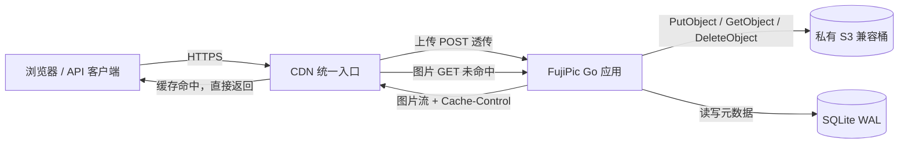

# FujiPic 实施计划

> 轻量、简洁的多用户图床  
> 版本：v1.1 · 日期：2026-11-09 · 状态：已实现（M0–M4；M5/M6 部分验证）  
> v1.1 修订：CDN 作为统一入口；上传透传、图片首次回源、后续 CDN 命中；S3 桶保持私有。

> 审查说明（2026-11-10）：本文保留原设计与历史验收记录，不是逐项实现保证。
> 运行配置以 README、`.env.example` 和当前代码为准；例如当前使用 Go 1.27、
> 全局管理员存储桶池，未包含 `internal/testcdn`、本地 S3 模拟器或每日 GC/对账任务。
> 下文原设想中的交互式密码、Cookie/哈希参数及 API 示例也可能与现实现不同。
> 历史静态审查边界见 [审查清单](docs/archive/AUDIT-2026-11-10.md)；当前运维入口见 [文档索引](docs/README.md)。

## 0. 一页结论

| 项目 | 决定 |
| --- | --- |
| 产品形态 | 单实例、多用户图床，中文 Web 界面 + HTTP API |
| 后端 | Go 单二进制，标准库 `net/http`，不引入 Web 框架 |
| 数据库 | SQLite（WAL 模式），单文件、零运维 |
| 对象存储 | 私有云 S3 兼容桶：AWS S3 / OCI Object Storage；管理员配置的全局多桶池（容量 + 优先级 + 自动溢出） |
| 前端 | Go `html/template` + 原生 JS/CSS，无 Node 构建步骤 |
| 认证 | 浏览器 Session Cookie + CSRF；API 使用 Bearer Token |
| 部署 | Docker 单容器 + Caddy/Nginx 源站 + CDN 公网入口；本地开发用内存驱动或云测试桶 |
| CDN 角色 | 统一入口：上传请求透传，图片首次回源、之后 CDN 缓存分发 |
| 图片交付 | 浏览器 → CDN → Go 应用 → 私有 S3；CDN 命中时不再回源 |
| 预计工期 | 约 7.5 人日（M0–M6） |
| 核心取舍 | 先做对、再做多；v1 不做图片处理、不做分布式、不做 SPA |

**一句话架构：** 浏览器或 API 客户端先把图片传到 CDN，CDN 将上传请求透传到 Go 应用；应用校验、计算哈希、检查配额后写入 S3 兼容桶。图片读取同样先到 CDN：首次未命中时回源 Go 应用，由应用从 S3 流式读取并返回；CDN 按响应头缓存，后续请求直接由 CDN 分发，不再回源。

---

## 1. 需求与边界

### 1.1 必须满足

| 需求 | v1 实现方式 | 验收标准 |
| --- | --- | --- |
| 网站登录上传 | 邮箱 + 密码登录，Session Cookie；登录后拖拽/粘贴/选择文件上传 | 登录后能上传，页面显示进度和结果，可复制 URL/Markdown |
| API 上传 | `POST /api/v1/upload`，`Authorization: Bearer fp_...` | curl 一条命令上传成功并返回 JSON |
| 后端使用存储桶 | S3 兼容对象存储，应用通过 AWS SDK v2 读写；桶保持私有 | 桶中出现对象，应用可读取；匿名直接访问桶被拒绝 |
| CDN 缓存与分发 | 上传和图片读取都经过 CDN；图片首次回源应用，之后 CDN 命中 | 同一图片 URL 第二次请求 CDN HIT，源站日志只出现一次 |
| 多用户认证 | 用户表、注册/登录/登出、角色、Session、API Token、配额 | 用户 A 无法查看/删除用户 B 的图片；管理员可禁用用户 |
| 轻量简洁 | 单二进制 + SQLite + 无前端构建 + 无 Redis | 空闲内存约 30–60 MB，1 vCPU 可运行 |
| 基本安全 | Argon2id、CSRF、限流、类型/大小/像素校验、配额 | 超限、伪造类型、SVG、越权、撤销 Token 均被拒绝 |

### 1.2 v1 明确不做

- 不做图片编辑、裁剪、水印、相册/文件夹。
- 不做图片压缩、缩略图、WebP/AVIF 转码（后续可接 imgproxy）。
- 不做 OAuth/OIDC、邮箱验证、邮件找回密码、2FA。
- 不做多租户团队/组织，只做独立用户 + 管理员。
- 不做分布式部署、Redis、消息队列、Postgres（预留迁移路径）。
- 不做私有图片/临时签名 URL（数据模型预留 `visibility` 字段）。
- 不做浏览器直传桶（Presigned PUT）；v1 统一走服务端上传，便于校验和隐藏凭据。
- 不做 CDN 直接回源 S3；CDN 只回源 Go 应用，S3 桶保持私有。

### 1.3 默认假设

- 单实例部署，用户规模 < 10,000，图片总量 < 1 TB。
- CDN 由你配置：缓存规则、TLS、回源地址、上传大小/超时、缓存刷新；应用负责提供正确的缓存头和回源接口。
- CDN 是唯一公网入口；源站通过防火墙、共享密钥或隧道限制直接访问。
- 图片默认公开，因此 `/i/*` 可被 CDN 缓存；私有图片后续单独设计。
- 删除图片时尽量刷新 CDN 缓存，但缓存刷新是最终一致；未配置刷新时需在 CDN 控制台手工清理。
- 界面默认中文，现代浏览器（Chrome/Safari/Firefox/Edge 最近两个大版本）。
- 生产环境使用 HTTPS；应用部署在反向代理之后。
- 对象存储使用云上私有 S3 兼容桶（AWS S3、OCI Object Storage）；不内置本地 S3 模拟器。
- 不依赖邮件服务；管理员通过 CLI 重置密码、创建邀请码。

---

## 2. 技术方案

### 2.1 选型

| 领域 | 选择 | 理由 |
| --- | --- | --- |
| 语言 | Go 1.27+ | 单二进制、内存占用低、标准库 HTTP 足够、交叉编译方便 |
| HTTP | `net/http` + Go 1.22+ `ServeMux` | 支持 `GET /path/{id}` 路由模式，无需 chi/gin |
| 数据库 | SQLite + `modernc.org/sqlite` | 纯 Go、无 cgo，静态编译；单文件备份简单 |
| 对象存储 | AWS SDK for Go v2（S3） | 兼容 AWS S3、OCI Object Storage 等 S3 API，避免供应商锁定 |
| 模板 | `html/template` + `embed` | 模板和静态资源编进二进制，部署只需一个文件 |
| 前端 | 原生 JS + 手写 CSS | 无 npm、无打包、无 Node 运行时 |
| 密码 | `golang.org/x/crypto/argon2` | Argon2id 是当前推荐的口令哈希 |
| 限流 | `golang.org/x/time/rate` + 内存 Map | 单实例足够；未来可换 Redis |
| 日志 | `log/slog` JSON | 标准库、结构化、易接入采集 |
| 迁移 | 内嵌 SQL + `schema_migrations` 表 | 不引入迁移工具，启动时自动执行 |

运行时依赖只有：`aws-sdk-go-v2`、`modernc.org/sqlite`、`x/crypto`、`x/image`（WebP 解码）、`x/time`。没有 Node、Redis、消息队列。

### 2.2 为什么不是其他方案

- **Next.js / Node 全栈**：功能没问题，但需要 Node 运行时、依赖安装和构建产物，镜像和内存占用都更大；本项目页面简单，服务端模板足够。
- **Cloudflare Workers + D1**：非常轻，但绑定 Cloudflare，且部分地区访问不稳定。若你确定只用 Cloudflare，可把本文的 Go 应用替换为 Workers/Hono，API 与数据模型不变。
- **Postgres**：更利于并发和扩容，但单实例图床用 SQLite WAL 足够，少一个需要运维的组件。达到瓶颈时再迁移。
- **浏览器直传 S3**：省服务器带宽，但需要暴露预签名逻辑、处理 CORS、无法在服务端可靠校验图片和配额。v1 选择服务端上传，逻辑更简单、更安全。

### 2.3 架构图



默认使用两个 CDN 域名：`pic.example.com` 承载网站和 API，`img.example.com` 承载图片。两者都回源到同一个 Go 应用；图片域名单独隔离 Cookie，并单独配置缓存规则。

### 2.4 关键请求流

1. **网页上传**：浏览器 → CDN（`pic.example.com`，POST 不缓存）→ Go 应用 → 登录 Cookie + CSRF 校验 → 图片校验 → 配额预占 → 写入 S3 → 写元数据 → 返回 JSON。CDN 不缓存上传响应。
2. **API 上传**：客户端 → CDN（`pic.example.com`，POST 透传）→ Go 应用 → Bearer Token 校验 → 同一套上传管线 → 返回 JSON。
3. **图片首次访问**：浏览器 → CDN（`img.example.com`，MISS）→ Go 应用 `GET /i/{key}` → S3 `GetObject` → 应用流式返回并设置缓存头 → CDN 缓存 → 浏览器。
4. **图片后续访问**：浏览器 → CDN（HIT）→ 浏览器。Go 应用和 S3 都不再收到请求。
5. **删除**：校验归属 → 数据库标记删除并归还配额 → 删除 S3 对象 → 加入 CDN 刷新队列；S3 删除或 CDN 刷新失败都有补偿重试。
6. **管理**：管理员在 `/admin` 管理用户、配额、邀请码；所有敏感操作写审计日志。

---

## 3. 仓库结构

```text
.
├── cmd/fujipic/
│   └── main.go              # serve / admin / backup 子命令
├── internal/
│   ├── config/              # 环境变量加载与校验
│   ├── db/                  # SQLite 连接、迁移、查询
│   ├── auth/                # Argon2id、Session、Token、CSRF
│   ├── storage/             # Storage 接口 + S3 实现 + 内存 Fake
│   ├── imagefile/           # 类型探测、尺寸校验、哈希、临时文件
│   ├── imageproxy/          # /i/* 回源、HEAD/Range/条件请求、缓存头
│   ├── cdn/                 # CDN 刷新适配器（Cloudflare / 通用 / 空实现）
│   ├── testcdn/             # 测试用最小缓存反向代理（MISS/HIT）
│   ├── upload/              # 上传/删除/配额/去重业务逻辑
│   ├── httpapi/             # JSON API、中间件、错误格式
│   └── web/                 # 页面 handler、模板、静态资源
├── migrations/
│   └── 0001_init.sql
├── web/
│   ├── templates/           # layout/login/register/dashboard/settings/admin
│   └── static/              # app.css、app.js、favicon
├── deploy/
│   ├── Dockerfile
│   ├── compose.prod.yml     # app + Caddy
│   └── Caddyfile
├── docs/
│   ├── openapi.yaml         # M4 产出
│   └── CDN.md               # 缓存规则、回源、刷新、验收步骤
├── scripts/
│   └── verify-cdn.sh        # staging CDN 的 MISS/HIT/上传/刷新冒烟脚本
├── PLAN.md
├── README.md
├── go.mod
└── go.sum
```

约束：`internal/storage` 只暴露接口，业务层不直接依赖 AWS SDK；这样单元测试可用内存 Fake，S3 适配器测试用 HTTP 测试替身。

## 4. 数据模型

SQLite 开启 `journal_mode=WAL`、`foreign_keys=ON`、`busy_timeout=5000`。时间统一存 Unix 秒，API 输出 RFC3339 UTC。ID 使用 `crypto/rand` 生成 16 字节随机数并编码为 base32（无填充），加前缀：`usr_`、`img_`、`tok_`、`ses_`。

```sql
CREATE TABLE schema_migrations (
  version    INTEGER PRIMARY KEY,
  applied_at INTEGER NOT NULL
);

CREATE TABLE users (
  id            TEXT PRIMARY KEY,
  email         TEXT NOT NULL UNIQUE COLLATE NOCASE,
  password_hash TEXT NOT NULL,
  role          TEXT NOT NULL DEFAULT 'user' CHECK (role IN ('user','admin')),
  status        TEXT NOT NULL DEFAULT 'active' CHECK (status IN ('active','disabled')),
  quota_bytes   INTEGER NOT NULL DEFAULT 1073741824,
  used_bytes    INTEGER NOT NULL DEFAULT 0 CHECK (used_bytes >= 0),
  created_at    INTEGER NOT NULL,
  updated_at    INTEGER NOT NULL
);

CREATE TABLE sessions (
  id           TEXT PRIMARY KEY,
  user_id      TEXT NOT NULL REFERENCES users(id) ON DELETE CASCADE,
  token_hash   TEXT NOT NULL UNIQUE,
  ip           TEXT,
  user_agent   TEXT,
  created_at   INTEGER NOT NULL,
  last_seen_at INTEGER NOT NULL,
  expires_at   INTEGER NOT NULL
);
CREATE INDEX idx_sessions_user ON sessions(user_id);
CREATE INDEX idx_sessions_expires ON sessions(expires_at);

CREATE TABLE api_tokens (
  id           TEXT PRIMARY KEY,
  user_id      TEXT NOT NULL REFERENCES users(id) ON DELETE CASCADE,
  name         TEXT NOT NULL,
  token_hash   TEXT NOT NULL UNIQUE,
  token_prefix TEXT NOT NULL,
  scopes       TEXT NOT NULL DEFAULT 'upload,read,delete',
  created_at   INTEGER NOT NULL,
  last_used_at INTEGER,
  expires_at   INTEGER
);
CREATE INDEX idx_tokens_user ON api_tokens(user_id);

CREATE TABLE images (
  id            TEXT PRIMARY KEY,
  user_id       TEXT NOT NULL REFERENCES users(id) ON DELETE CASCADE,
  object_key    TEXT NOT NULL UNIQUE,
  original_name TEXT,
  mime          TEXT NOT NULL,
  size_bytes    INTEGER NOT NULL,
  width         INTEGER,
  height        INTEGER,
  sha256        TEXT NOT NULL,
  visibility    TEXT NOT NULL DEFAULT 'public' CHECK (visibility IN ('public','private')),
  created_at    INTEGER NOT NULL,
  deleted_at    INTEGER
);
CREATE INDEX idx_images_user_created ON images(user_id, created_at DESC);
CREATE UNIQUE INDEX idx_images_user_sha_active
  ON images(user_id, sha256) WHERE deleted_at IS NULL;

CREATE TABLE invites (
  code       TEXT PRIMARY KEY,
  created_by TEXT REFERENCES users(id),
  used_by    TEXT REFERENCES users(id),
  created_at INTEGER NOT NULL,
  expires_at INTEGER
);

CREATE TABLE pending_deletes (
  object_key TEXT PRIMARY KEY,
  created_at INTEGER NOT NULL
);

CREATE TABLE cdn_purges (
  url        TEXT PRIMARY KEY,
  created_at INTEGER NOT NULL,
  attempts   INTEGER NOT NULL DEFAULT 0,
  last_error TEXT
);
CREATE INDEX idx_cdn_purges_created ON cdn_purges(created_at);

CREATE TABLE audit_logs (
  id         TEXT PRIMARY KEY,
  actor_id   TEXT REFERENCES users(id),
  action     TEXT NOT NULL,
  target     TEXT,
  ip         TEXT,
  meta       TEXT,
  created_at INTEGER NOT NULL
);
CREATE INDEX idx_audit_created ON audit_logs(created_at DESC);
```

### 4.1 设计说明

- **`users.used_bytes` 是配额计数器**：上传/删除时与 `images` 在同一事务内更新，避免每次上传都 `SUM()`。每日对账任务可修正漂移。
- **去重是“同一用户内去重”**：`UNIQUE(user_id, sha256) WHERE deleted_at IS NULL`。不同用户上传同一文件互不可见，避免隐私泄露。
- **软删除**：`deleted_at` 非空即不可见；S3 对象删除失败由 `pending_deletes` 补偿，CDN 刷新失败由 `cdn_purges` 补偿。历史元数据保留 30 天后可清理。
- **CDN 刷新队列**：删除图片时写入 `cdn_purges(url)`，后台按 CDN 提供商 API 刷新；未配置刷新时保留记录并提示管理员手工处理。
- **`token_hash` 只存 SHA-256**：数据库泄露不能直接得到可用 Token；`token_prefix` 仅用于界面识别。
- **`sessions` 可多设备登录**：修改密码时删除该用户其他 Session；禁用用户时所有 Session 和 Token 立即失效。
- **`invites` 默认一次性**：注册成功时在事务内写入 `used_by`；已使用或过期的邀请码不可再用。
- **`audit_logs` 只追加**：管理员改配额、禁用用户、创建邀请码、删除图片时写入。

### 4.2 关键查询

```sql
-- 登录：按邮箱取用户
SELECT id, password_hash, role, status, quota_bytes, used_bytes
FROM users WHERE email = ? COLLATE NOCASE;

-- Session 校验：按哈希取用户
SELECT u.id, u.email, u.role, u.status, u.quota_bytes, u.used_bytes,
       s.id AS session_id, s.expires_at
FROM sessions s JOIN users u ON u.id = s.user_id
WHERE s.token_hash = ? AND s.expires_at > ?;

-- 配额预占：原子检查并扣减
UPDATE users
SET used_bytes = used_bytes + ?, updated_at = ?
WHERE id = ? AND status = 'active' AND used_bytes + ? <= quota_bytes;

-- 图片列表：游标分页
SELECT id, object_key, original_name, mime, size_bytes, width, height,
       sha256, created_at
FROM images
WHERE user_id = ? AND deleted_at IS NULL
  AND (created_at < ? OR (created_at = ? AND id < ?))
ORDER BY created_at DESC, id DESC
LIMIT ?;
```

---

## 5. 认证与多用户

### 5.1 注册与首个管理员

- 默认**邀请制**：注册页要求填写邀请码；管理员在后台生成一次性邀请码（可设过期时间）。
- `ALLOW_OPEN_REGISTRATION=true` 时开放注册，适合内网或小团队；仍保留限流和邮箱唯一约束。
- 首个管理员两种方式：
  1. 启动时若 `users` 为空且设置了 `BOOTSTRAP_ADMIN_EMAIL` + `BOOTSTRAP_ADMIN_PASSWORD`，创建管理员并打印一次警告，建议创建后移除环境变量。
  2. `fujipic admin create --email admin@example.com` 交互式输入密码（推荐生产使用）。
- v1 不做邮箱验证和邮件找回密码；管理员可用 `fujipic admin reset-password --email ...` 重置。
- 邮箱统一转小写存储；密码长度 10–128 字符，不做复杂的字符类别强制，但拒绝常见弱口令（内置一个小型列表即可）。

### 5.2 密码哈希

- 算法：Argon2id，参数默认 `m=19456 KiB (19 MiB), t=2, p=1`，salt 16 字节，输出 32 字节，编码为 PHC 字符串。
- 这是 OWASP 的低内存基线；如果机器内存充足，可调高到 `m=47104, t=1, p=1`。参数写入哈希字符串，后续可平滑升级。
- 使用带缓冲的信号量限制**同时进行的密码哈希**为 2–4 个，防止登录洪水把内存打满。
- 登录时对不存在的邮箱也执行一次 dummy Argon2 校验，避免通过响应时间枚举邮箱。
- 校验使用 `subtle.ConstantTimeCompare`；错误信息统一为“邮箱或密码错误”。

### 5.3 Session 与 CSRF

- 登录成功后生成 32 字节随机 Token，Base64URL 编码，写入 Cookie：
  - 生产：`__Host-fp_session`，`HttpOnly`、`Secure`、`SameSite=Lax`、`Path=/`、无 `Domain`。
  - 开发：`fp_session`，允许 `Secure=false`。
- 数据库只存 Token 的 SHA-256；Session 默认 30 天过期，滑动续期（`last_seen_at` 最多每小时更新一次）。
- 登录时轮换 Session ID，防止会话固定；登出删除当前 Session；修改密码删除该用户其他 Session。
- CSRF 采用双提交 Cookie：
  - `__Host-fp_csrf`（非 HttpOnly）+ 请求头 `X-CSRF-Token` 或表单字段 `_csrf`。
  - 所有 Cookie 认证的 `POST/PUT/PATCH/DELETE` 必须校验；Bearer Token 请求不需要 CSRF。
  - 登录/注册页也下发匿名 CSRF Cookie，防止登录 CSRF。
  - 额外校验 `Origin`/`Referer` 与 `APP_BASE_URL` 同源，作为纵深防御。
- 安全响应头：`Strict-Transport-Security`、`X-Content-Type-Options: nosniff`、`X-Frame-Options: DENY`、`Referrer-Policy: strict-origin-when-cross-origin`、CSP（见第 8 节）。

### 5.4 API Token

- 格式：`fp_` + 32 字节随机数的 Base64URL，例如 `fp_xxxxxxxx...`，只在创建时显示一次。
- 数据库存 SHA-256 和前缀；界面显示 `fp_abcd…`、名称、权限、最后使用时间、过期时间。
- 权限（scope）：
  - `upload`：上传；
  - `read`：列表、详情、`/me`；
  - `delete`：删除自己的图片。
- 默认创建 `upload,read,delete`；可为 CI 创建仅 `upload` 的 Token。
- 支持可选过期时间；撤销立即生效；`last_used_at` 每次请求更新（SQLite 单机可接受）。
- Token 管理接口只允许 Session 认证，防止被盗 Token 再创建新 Token。

### 5.5 权限矩阵

| 操作 | 未登录 | 普通用户 | 管理员 |
| --- | --- | --- | --- |
| 注册（邀请制） | 有邀请码可注册 | — | 创建邀请码 |
| 登录/登出 | 允许 | 允许 | 允许 |
| 上传图片 | 拒绝 | 自己的配额内 | 自己的配额内 |
| 查看/删除图片 | 拒绝 | 仅自己的 | 普通 API 仅自己的；网页登录后台可查看及删除全部用户图片 |
| 创建/撤销自己的 Token | 拒绝 | 允许 | 允许 |
| 查看用户列表 | 拒绝 | 拒绝 | 允许 |
| 禁用用户/改配额 | 拒绝 | 拒绝 | 允许，但不能禁用最后一个管理员 |
| 创建邀请码 | 拒绝 | 拒绝 | 允许 |
| 审计日志 | 拒绝 | 拒绝 | 允许 |

管理员可通过独立的 `/admin/images` 网页入口查看及删除用户图片；仅限管理员 Cookie 会话，删除需 CSRF，审计记录实际管理员。普通图片管理 API 不提升管理员权限，Bearer Token 不能访问管理后台。

### 5.6 限流

单实例内存令牌桶，按 key 计数；返回 `429` + `Retry-After`。

| 场景 | 限制 |
| --- | --- |
| 登录 | 每 IP 10 次/分钟；每邮箱 5 次/分钟 |
| 注册 | 每 IP 5 次/小时 |
| 上传 | 每用户/Token 60 次/分钟，突发 10 |
| 普通 API | 每 Token 300 次/分钟 |
| 密码修改 | 每用户 5 次/小时 |

IP 取值：默认 `RemoteAddr`；当 `TRUST_PROXY=true` 时，优先读取 CDN 提供的真实客户端 IP 头（如 `CF-Connecting-IP`、`X-Forwarded-For`），并只信任 CDN/反向代理网段，防止伪造。限流 Map 定期清理过期桶，防止内存增长。

### 5.7 管理员能力

- 用户列表：邮箱、角色、状态、配额、已用空间、图片数、注册时间。
- 禁用/启用用户；调整配额（可低于已用量，此时禁止继续上传）。
- 创建/作废邀请码；查看审计日志。
- 全局统计：用户数、图片数、总占用、今日上传数。
- CLI：创建管理员、重置密码、执行 GC/对账、备份数据库、手工刷新 CDN。

### 5.8 CDN 边缘与源站保护

- CDN 是唯一公网入口；源站只接受 CDN 回源流量。
- 源站保护三选一或组合：
  1. 防火墙只允许 CDN 出口 IP 段；
  2. CDN 注入 `X-Origin-Secret`，应用对所有非健康检查请求校验；
  3. Cloudflare Tunnel / mTLS / 私有网络直连。
- CDN 必须透传：`Authorization`、`Cookie`、`X-CSRF-Token`、`Origin`、`Content-Type`、`X-Filename`、`Range`、`If-None-Match`、`If-Modified-Since`。
- CDN 在图片域名上应剥离 `Cookie`/`Authorization`，缓存键只使用 URL，避免因用户身份导致缓存碎片。
- CDN 层可再叠加 WAF、登录/上传限流；应用层限流仍然保留，防止绕过 CDN 或 CDN 配置错误。
- 源站日志记录 CDN 请求 ID 和缓存状态（如 `CF-Cache-Status`、`X-Cache`），便于排查“为什么没命中”。

---

## 6. 存储桶与 CDN 回源

### 6.1 桶与权限

- 桶只存图片和可选备份，不存数据库主文件。
- 桶保持**私有**：不配置公开读、不绑定公开域名，CDN 不直接访问桶。
- 应用凭据最小权限：`s3:PutObject`、`s3:GetObject`、`s3:DeleteObject`、`s3:ListBucket`（GC 用）。`HeadObject` 由 `s3:GetObject` 覆盖。
- 所有图片读取都通过应用 `GET /i/{key}`，由 CDN 缓存；S3 只与 Go 应用通信。
- 关闭桶的目录列表；对象键含 128 位随机数，不可枚举。
- 图片域名与主站域名分开（`img.example.com` / `pic.example.com`），隔离 Cookie，降低 XSS 风险。
- 桶开启版本控制时注意：删除对象仍可能保留非当前版本，按生命周期清理；配额只统计逻辑图片。
- 服务器默认桶由 `S3_*` 配置，并以固定 ID `bkt_default` 存在于全局存储桶池；普通用户不能添加、删除或选择存储桶。
- 管理员在 `/admin` 配置多个 S3 兼容桶，每个桶可设置最大容量（`0` 为不限）和优先级（数字越小越先使用）；上传按优先级自动选择第一个启用且仍有容量的桶。
- 容量在写入对象前原子预留，写入失败归还；软删除图片归还桶容量；启动时按活跃图片重新校准 `used_bytes`。所有桶已满时 API 返回 `507 storage_full`。
- 添加自定义桶前执行 Put/Get/Delete 探针；凭据用 AES-256-GCM 加密存 SQLite，图片通过 `images.bucket_id` 关联。端点解析和拨号都拒绝内网、回环、链路本地及保留地址，防止 SSRF。
- 删除自定义桶前必须没有活跃图片、待重试删除任务或进行中的容量预留；软删除图片会先解除桶关联。服务器默认桶不能删除。

各平台接入示例：

| 平台 | Endpoint | Region | Path Style |
| --- | --- | --- | --- |
| AWS S3 | 留空（官方端点） | 对应 region | `false` |
| OCI Object Storage | `https://{namespace}.compat.objectstorage.{region}.oraclecloud.com` | 对应 region | `true` |
| 其他 S3 兼容云桶 | 厂商提供的兼容端点 | 对应 region | 以厂商文档为准 |

### 6.2 对象键与访问 URL

对象键格式：

```text
i/{yyyy}/{mm}/{26位base32随机串}.{ext}
```

- 随机串来自 `crypto/rand` 的 16 字节，128 位熵，不可猜测。
- 扩展名由**服务端探测到的 MIME** 决定，不使用用户文件名：
  - `image/jpeg` → `.jpg`
  - `image/png` → `.png`
  - `image/gif` → `.gif`
  - `image/webp` → `.webp`
- 原始文件名只存数据库，用于展示和下载名，不进入对象键，避免路径穿越和特殊字符问题。
- 图片访问 URL 指向 CDN 图片域名：

```text
PUBLIC_BASE_URL + "/i/" + strings.TrimPrefix(objectKey, "i/")
# 例：https://img.example.com/i/2026/11/7f3k9q2m....jpg
```

- 应用路由 `GET /i/{key...}` 接收 CDN 回源请求，校验 key 后从 S3 读取；API 永远返回 CDN URL，不返回 S3 endpoint。
- 写入桶时设置 `Content-Type`、`Cache-Control`、`Content-Disposition`；回源时应用再显式设置响应头，避免依赖桶的默认行为。

### 6.3 上传管线（经 CDN）

所有上传（网页/API）先到 CDN，再由 CDN 透传到应用。CDN 对 `POST` 必须**绕过缓存**，并完整转发请求体、`Authorization`、`Cookie`、`X-CSRF-Token`、`Content-Type`、`Content-Length`、`X-Filename`。

1. **CDN 入口**：不缓存 POST；请求体上限设为 `MAX_UPLOAD_BYTES + 1 MiB` 以上；回源超时至少 120 秒；不记录请求体。
2. **应用认证**：Bearer Token 或 Session Cookie；Cookie 方式校验 CSRF；检查用户 `status=active`。
3. **限流**：按用户/Token 计数，超限返回 429。
4. **请求体限制**：`http.MaxBytesReader` 限制为 `MAX_UPLOAD_BYTES + 1 MiB`（multipart 开销）。
5. **读取与嗅探**：读取前 512 字节，`http.DetectContentType` 得到 MIME；只允许 JPEG/PNG/GIF/WebP，**明确拒绝 SVG**（SVG 可含脚本）。
6. **解码校验**：用 `image.DecodeConfig` 读取宽高；限制最大像素 50 MP、最大边长 12000，防止解压炸弹。WebP 通过 `x/image/webp` 注册解码器。
7. **流式落盘**：边读边写临时文件，同时计算 SHA-256；临时文件放在 `TMP_DIR`，权限 0600，结束后删除。内存占用与图片大小无关。
8. **去重**：查询该用户是否已有相同 `sha256` 且未删除的图片；有则直接返回已有记录（`200`，`deduplicated: true`），不再写桶。
9. **配额预占**：执行原子 `UPDATE users ... WHERE used_bytes + ? <= quota_bytes`；影响行数为 0 返回 403。预占成功后才写桶。
10. **写入桶**：`PutObject` 使用临时文件（可 Seek），设置 Content-Type/Cache-Control；失败则释放配额并返回 502/500。
11. **写元数据**：在事务中插入 `images` 并确认配额已预占；唯一键冲突（并发重复上传）时删除刚写入的对象、释放配额，返回已存在记录。
12. **返回**：CDN 图片 URL、Markdown、HTML、尺寸、哈希、是否去重。

CDN 限制必须与 `MAX_UPLOAD_BYTES` 对齐：如果 CDN 单请求上限是 100 MB、超时 100 秒，建议把应用上限设为 10 MiB 或更低；慢速网络下 10 MiB 可能接近超时，必要时下调。

失败补偿：

- 桶写入成功但数据库写入失败：尽力 `DeleteObject`；失败则写入 `pending_deletes`。
- 进程在“预占配额”和“写元数据”之间崩溃：配额会暂时偏高；每日对账按 `SUM(images.size_bytes)` 修正。
- 临时文件使用 `defer os.Remove`，启动时清理超过 24 小时的残留临时文件。

### 6.4 去重与配额

- 去重范围：**同一用户内**。同一文件第二次上传返回第一次的 URL，节省空间。
- 不同用户上传相同文件各自存储，互不暴露“某人已上传过此文件”。
- 默认配额 1 GiB/用户，管理员可调整；`used_bytes` 只统计未删除图片的 `size_bytes`。
- 配额检查与扣减在一条 SQL 中完成，避免并发上传绕过限制。
- 删除时 `used_bytes = MAX(0, used_bytes - size)`，并在同一事务标记 `deleted_at`。
- 每日/手动对账：`used_bytes` 与 `SUM(size_bytes)` 不一致时告警并修正。

### 6.5 删除、CDN 刷新与补偿

1. 普通接口校验图片归属；独立管理员删除入口校验管理员身份，并从数据库取得真实归属，复用同一配额/存储/CDN 清理流程。
2. 事务：`UPDATE images SET deleted_at=?` + 扣减 `used_bytes`。
3. `DeleteObject`；成功则进入下一步，失败插入 `pending_deletes`。
4. 写入 `cdn_purges(url)`，其中 `url = PUBLIC_BASE_URL + "/i/" + keyWithoutPrefix`。
5. 后台 worker 调用 CDN 刷新 API；成功后删除队列记录，失败则增加 `attempts` 并退避重试。
6. 未配置 `CDN_PURGE_PROVIDER` 时保留记录并提示管理员手工刷新；UI 明确提示“删除后 CDN 缓存可能仍可访问”。
7. 元数据保留 30 天，之后由 `fujipic gc` 物理删除。

注意：CDN 缓存的删除是最终一致的。对象键唯一且不可变，正常访问不会串图；但在刷新完成前，已缓存 URL 仍可能返回旧图。对敏感图片，管理员应先刷新 CDN 再对外确认删除完成。

### 6.6 图片读取与 CDN 缓存

首次访问：

```text
浏览器 → CDN（MISS）→ Go 应用 GET /i/{key} → S3 GetObject → 应用流式返回 → CDN 缓存 → 浏览器
```

后续访问：

```text
浏览器 → CDN（HIT）→ 浏览器（Go 应用和 S3 均无请求）
```

应用回源处理：

1. 将路由捕获的 `key` 拼成 `i/` + key，校验匹配 `^i/\d{4}/\d{2}/[a-z2-7]{26}\.(jpg|png|gif|webp)$`；不匹配直接 404。
2. `HEAD` 用 `HeadObject`；`GET` 用 `GetObject`，支持 `Range` 透传。
3. 设置响应头：

```text
Cache-Control: public, max-age=31536000, immutable
CDN-Cache-Control: public, max-age=31536000
Content-Type: image/jpeg
Content-Length: 123456
ETag: "..."
Last-Modified: ...
Accept-Ranges: bytes
X-Content-Type-Options: nosniff
Content-Disposition: inline
```

4. 支持 `If-None-Match` / `If-Modified-Since`，命中返回 304（带缓存头）。
5. `Range` 请求返回 206 + `Content-Range`；CDN 配置为缓存 200/206/304。
6. 404/5xx 返回 `Cache-Control: no-store`，避免 CDN 缓存错误页。
7. `/i/*` 路由不加载 Session 中间件、不读取 Cookie；图片响应**不设置 Cookie**、不要求登录、不返回 `Vary: Cookie`；CDN 缓存键只使用 URL。
8. CDN 不对图片做压缩/转码/裁剪；保持原始字节和 Content-Type。

### 6.7 存储适配层

```go
type Object struct {
    Body         io.ReadCloser
    Size         int64
    ContentType  string
    ETag         string
    LastModified time.Time
    ContentRange string
    StatusCode   int
}

type Store interface {
    Put(ctx context.Context, key string, body io.Reader, size int64, contentType string) error
    Get(ctx context.Context, key, rangeHeader string) (*Object, error)
    Head(ctx context.Context, key string) (*Object, error)
    Delete(ctx context.Context, key string) error
    Health(ctx context.Context) error
}
```

- `s3Store`：AWS SDK v2 实现；`NoSuchKey` 映射为 `ErrNotFound`；`Get` 返回的 `Body` 必须由调用方关闭。
- `memoryStore`：单元测试用，支持 Put/Get/Head/Delete，记录对象和调用次数。
- 集成测试用内存 Fake 和 HTTP S3 测试替身，断言对象真实存在、Content-Type 正确、Range/HEAD 正确、删除后 404；真实云桶验收需单独提供凭据。

### 6.8 CDN 配置要求

| 项目 | 建议配置 |
| --- | --- |
| 域名 | `pic.example.com` 承载网站/API；`img.example.com` 承载图片；两者都指向 CDN |
| 回源 | CDN 回源 Go 应用；HTTPS Full (strict)、Cloudflare Tunnel 或私有网络 |
| 源站保护 | 防火墙仅放行 CDN 出口 IP；或 CDN 注入 `X-Origin-Secret`；应用校验 |
| `/i/*` 缓存 | 缓存 1 年；缓存键只用 URL；忽略 Cookie/Authorization；缓存 200/206/304；不缓存 4xx/5xx |
| 图片请求头 | 透传 `Range`、`If-None-Match`、`If-Modified-Since`；剥离 `Cookie`、`Authorization` |
| Range 缓存 | 优先缓存完整 200 并由 CDN 处理 Range；若缓存 206，确认不会把部分内容当完整对象 |
| 上传路径 | `/api/*`、`/upload`、`/login`、`/register`、`/settings`、`/admin`、`/logout` 全部 bypass |
| 上传限制 | POST 不缓存；请求体上限 ≥ 12 MiB；回源超时 ≥ 120 秒；不记录请求体 |
| 上传请求头 | 透传 `Authorization`、`Cookie`、`X-CSRF-Token`、`Content-Type`、`Content-Length`、`X-Filename` |
| 响应头 | 不剥离 `Cache-Control`、`CDN-Cache-Control`、`ETag`、`Content-Type`、`Content-Length`、`Accept-Ranges` |
| 静态资源 | `/static/*` 可缓存 7 天或 1 年（文件名/查询参数带版本） |
| 健康检查 | `/healthz`、`/readyz` bypass，最好只允许内网/监控访问 |
| 缓存刷新 | 配置 CDN 刷新 API；应用删除图片时自动刷新；失败重试 |
| 日志 | 记录缓存状态（`CF-Cache-Status`/`X-Cache`）和请求 ID；不记录请求体/响应体 |

TTL 由你的 CDN 策略决定；应用默认发送 1 年 `immutable`，CDN 可按需覆盖。如果只用一个域名，也可以按路径配置：`/i/*` 缓存，其余 bypass；但推荐两个域名，避免图片请求携带主站 Cookie，并简化缓存规则。

---

## 7. API 设计

### 7.1 通用约定

- Base URL：`https://pic.example.com/api/v1`（先经过 CDN，再回源应用）
- 图片 Base URL：`https://img.example.com/i/...`（先经过 CDN，未命中时回源应用）
- 请求/响应均为 UTF-8 JSON（上传除外）；所有 `/api/*` 响应设置 `Cache-Control: no-store`。
- 时间：RFC3339 UTC，如 `2026-11-09T12:00:00Z`。
- 认证：
  - `Authorization: Bearer fp_...` 用于 API；
  - Session Cookie 用于网页；两者同时存在时以 Bearer 为准。
- Cookie 认证的写操作必须带 `X-CSRF-Token`；Bearer 不需要。
- 请求 ID：接受并回显 `X-Request-ID`，没有则生成。
- 分页：`limit`（默认 20，最大 100）+ 不透明 `cursor`。
- 错误统一格式：

```json
{
  "error": {
    "code": "quota_exceeded",
    "message": "存储配额不足",
    "details": { "quota_bytes": 1073741824, "used_bytes": 1073740000 }
  }
}
```

### 7.2 端点总览

| 方法 | 路径 | 认证 | 说明 |
| --- | --- | --- | --- |
| POST | `/api/v1/upload` | Bearer 或 Cookie+CSRF | 上传一张图片 |
| GET | `/api/v1/images` | Bearer（read）或 Cookie | 当前用户图片列表 |
| GET | `/api/v1/images/{id}` | Bearer（read）或 Cookie | 图片元数据 |
| DELETE | `/api/v1/images/{id}` | Bearer（delete）或 Cookie+CSRF | 删除自己的图片 |
| GET | `/api/v1/me` | Bearer（read）或 Cookie | 当前用户与配额 |
| GET | `/api/v1/tokens` | 仅 Cookie | 列出自己的 Token（脱敏） |
| POST | `/api/v1/tokens` | 仅 Cookie+CSRF | 创建 Token（只显示一次） |
| DELETE | `/api/v1/tokens/{id}` | 仅 Cookie+CSRF | 撤销 Token |
| GET | `/healthz` | 无 | 存活检查 |
| GET | `/readyz` | 无 | 数据库 + 桶就绪检查 |

网页路由：

| 方法 | 路径 | 说明 |
| --- | --- | --- |
| GET | `/` | 未登录跳 `/login`，已登录跳 `/dashboard` |
| GET/POST | `/login` | 登录页/登录 |
| GET/POST | `/register` | 注册页/注册（邀请码） |
| POST | `/logout` | 登出 |
| GET | `/dashboard` | 上传 + 图库 |
| POST | `/upload` | 无 JS 回退上传，303 回 dashboard |
| GET | `/settings` | Token、密码、会话管理 |
| POST | `/settings/password` | 修改密码 |
| GET | `/admin` | 管理后台 |
| POST | `/admin/users/{id}/status` | 禁用/启用 |
| POST | `/admin/users/{id}/quota` | 调整配额 |
| POST | `/admin/invites` | 创建邀请码 |

公开图片路由（供 CDN 回源）：

| 方法 | 路径 | 说明 |
| --- | --- | --- |
| GET/HEAD | `/i/{key...}` | 公开图片；校验 key 后从 S3 流式读取；设置长缓存头；CDN 缓存 |

图片回源响应头示例：

```http
Cache-Control: public, max-age=31536000, immutable
CDN-Cache-Control: public, max-age=31536000
Content-Type: image/jpeg
Content-Length: 123456
ETag: "9f86d081..."
Last-Modified: Mon, 09 Nov 2026 12:00:00 GMT
Accept-Ranges: bytes
X-Content-Type-Options: nosniff
Content-Disposition: inline
```

- 404/5xx 必须返回 `Cache-Control: no-store`，避免 CDN 缓存错误页。
- 图片响应不得设置 `Set-Cookie`，也不要求登录；CDN 缓存键只用 URL。
- `HEAD` 与 `GET` 返回相同头部；`Range` 透传 S3，返回 206 + `Content-Range`。

### 7.3 上传接口

上传请求先到 CDN：CDN 必须对 `POST` **bypass 缓存**，并透传请求体、`Authorization`、`Cookie`、`X-CSRF-Token`、`Content-Type`、`Content-Length`、`X-Filename`。应用仍然执行全部校验，不能依赖 CDN。

**multipart（推荐）**

```http
POST /api/v1/upload HTTP/1.1
Host: pic.example.com
Authorization: Bearer fp_xxxxxxxx
Content-Type: multipart/form-data; boundary=----fujipic

------fujipic
Content-Disposition: form-data; name="file"; filename="cat.png"
Content-Type: image/png

<binary>
------fujipic--
```

字段：

| 字段 | 必填 | 说明 |
| --- | --- | --- |
| `file` | 是 | 图片文件；v1 每次请求一张 |
| `name` | 否 | 展示用文件名，最长 200 字符，仅存元数据 |
| `visibility` | 否 | v1 只接受 `public` |

**原始二进制（适合脚本）**

```http
POST /api/v1/upload HTTP/1.1
Authorization: Bearer fp_xxxxxxxx
Content-Type: image/png
X-Filename: cat.png

<binary>
```

成功 `201 Created`（去重时 `200 OK`）：

```json
{
  "id": "img_7f3k9q2m...",
  "url": "https://img.example.com/i/2026/11/7f3k9q2m....png",
  "markdown": "",
  "html": "",
  "mime": "image/png",
  "size": 123456,
  "width": 800,
  "height": 600,
  "sha256": "9f86d081...",
  "deduplicated": false,
  "created_at": "2026-11-09T12:00:00Z"
}
```

### 7.4 列表、详情、删除

**列表**

```http
GET /api/v1/images?limit=20&cursor=eyJjcmVhdGVkX2F0IjoxNzY...
Authorization: Bearer fp_xxxxxxxx
```

```json
{
  "items": [
    {
      "id": "img_...",
      "url": "https://img.example.com/i/2026/11/....jpg",
      "name": "cat.jpg",
      "mime": "image/jpeg",
      "size": 123456,
      "width": 800,
      "height": 600,
      "created_at": "2026-11-09T12:00:00Z"
    }
  ],
  "next_cursor": "eyJjcmVhdGVkX2F0IjoxNzY..."
}
```

**详情**：`GET /api/v1/images/{id}`，返回单条元数据；不存在或不属于当前用户统一返回 `404`，避免枚举。

**删除**：`DELETE /api/v1/images/{id}`，成功 `204 No Content`；重复删除也返回 `204`（幂等）。

**当前用户**：

```json
{
  "id": "usr_...",
  "email": "user@example.com",
  "role": "user",
  "quota_bytes": 1073741824,
  "used_bytes": 123456,
  "image_count": 2,
  "created_at": "2026-11-09T12:00:00Z"
}
```

### 7.5 Token 管理

创建（仅 Cookie 会话）：

```json
{
  "name": "ci-upload",
  "scopes": ["upload"],
  "expires_at": "2027-01-01T00:00:00Z"
}
```

响应（`token` 只出现这一次）：

```json
{
  "id": "tok_...",
  "name": "ci-upload",
  "token": "fp_xxxxxxxxxxxxxxxxxxxxxxxxxxxxxxxx",
  "prefix": "fp_xxxx",
  "scopes": ["upload"],
  "created_at": "2026-11-09T12:00:00Z",
  "expires_at": "2027-01-01T00:00:00Z"
}
```

列表只返回 `prefix`、名称、权限、最后使用时间、过期时间；不返回完整 Token。撤销后立即失效。

### 7.6 错误码

| HTTP | code | 场景 |
| --- | --- | --- |
| 400 | `invalid_request` | 参数缺失、multipart 损坏、文件名过长 |
| 401 | `unauthorized` | 未登录、Token 无效/过期/撤销 |
| 403 | `forbidden` | 权限不足、用户被禁用、CSRF 失败 |
| 403 | `quota_exceeded` | 超出用户配额 |
| 404 | `not_found` | 图片/Token 不存在或不属于当前用户 |
| 409 | `conflict` | 并发写入冲突（可重试） |
| 413 | `payload_too_large` | 超过 `MAX_UPLOAD_BYTES` |
| 415 | `unsupported_media_type` | 非 JPEG/PNG/GIF/WebP，或伪造扩展名 |
| 422 | `invalid_image` | 图片解码失败、像素/尺寸超限 |
| 429 | `rate_limited` | 触发限流 |
| 500 | `internal_error` | 未预期错误（不返回内部细节） |
| 502 | `storage_error` | 桶写入/读取失败 |

### 7.7 调用示例

```bash
# API 上传
curl -sS -X POST https://pic.example.com/api/v1/upload \
  -H "Authorization: Bearer fp_xxxxxxxx" \
  -F "file=@cat.png"

# 原始二进制上传
curl -sS -X POST https://pic.example.com/api/v1/upload \
  -H "Authorization: Bearer fp_xxxxxxxx" \
  -H "Content-Type: image/jpeg" \
  --data-binary @photo.jpg

# 列表
curl -sS "https://pic.example.com/api/v1/images?limit=20" \
  -H "Authorization: Bearer fp_xxxxxxxx"

# 删除
curl -sS -X DELETE https://pic.example.com/api/v1/images/img_xxxx \
  -H "Authorization: Bearer fp_xxxxxxxx"

# 图片首次访问（CDN MISS，回源应用）
curl -sSI https://img.example.com/i/2026/11/7f3k9q2m....jpg

# 再访问一次（应看到 CDN HIT，且源站无新请求）
curl -sSI https://img.example.com/i/2026/11/7f3k9q2m....jpg
```

CDN 缓存状态头因提供商而异：Cloudflare 为 `cf-cache-status: MISS/HIT`，CloudFront 为 `x-cache: Miss from cloudfront/Hit from cloudfront`，Bunny 为 `X-Cache: MISS/HIT`。

M4 产出 `docs/openapi.yaml`，与本文保持一致；CI 用 `openapi-generator` 或 `spectral` 做基本校验（可选）。

---

## 8. Web 界面

### 8.1 页面与交互

| 页面 | 内容 |
| --- | --- |
| `/login` | 邮箱、密码、登录；错误提示；注册入口 |
| `/register` | 邮箱、密码、确认密码、邀请码（开放注册时隐藏） |
| `/dashboard` | 拖拽区、文件选择、剪贴板粘贴、上传队列/进度、结果复制、配额条、图库 |
| `/settings` | 修改密码、API Token 列表/创建/撤销、退出所有设备 |
| `/admin` | 用户列表、禁用/启用、配额编辑、邀请码、统计、审计日志 |

图库交互：

- 网格布局，`loading="lazy"`，分页/“加载更多”；v1 直接加载原图，不生成缩略图（避免图片处理依赖）。
- 每张图提供“复制链接 / Markdown / HTML”按钮，复制成功有 toast。
- 删除需二次确认；删除后从列表移除并更新配额。
- 上传支持多选，前端串行或最多 2 并发，避免内存和带宽峰值。
- 无 JS 回退：普通 `<form enctype="multipart/form-data">` 提交到 `/upload`，服务端 303 回 dashboard。
- 移动端单列；键盘可操作；上传状态用 `aria-live` 播报。
- 深色/浅色跟随 `prefers-color-scheme`；系统字体；不引用第三方前端 CDN 资源（JS/CSS/字体全部本地）。
- 网页上传和 API 上传都先到 CDN；图库里的图片 URL 指向 `img.example.com`（CDN），不是 S3 endpoint。
- HTML 页面和 `/api/*` 响应使用 `Cache-Control: no-store`；`/static/*` 可长缓存，资源带版本查询参数。
- 删除图片后，前端提示“CDN 缓存刷新可能需要几秒到几分钟”；后台自动刷新，失败时提示管理员手工处理。

### 8.2 前端实现

- `web/templates/`：`layout.html`、`login.html`、`register.html`、`dashboard.html`、`settings.html`、`admin.html`。
- `web/static/app.js`：上传（XHR 获取进度）、复制、删除确认、Token 创建弹窗；约 200–300 行，无框架。
- `web/static/app.css`：手写，约 300–400 行，CSS 变量支持主题。
- 模板通过 `//go:embed templates static` 编入二进制；生产不读磁盘静态文件。
- 所有用户输入经 `html/template` 自动转义；不要用 `template.HTML` 拼接用户内容。

### 8.3 安全响应头与 CSP

```text
Strict-Transport-Security: max-age=31536000; includeSubDomains
X-Content-Type-Options: nosniff
X-Frame-Options: DENY
Referrer-Policy: strict-origin-when-cross-origin
Permissions-Policy: camera=(), microphone=(), geolocation=()
Cross-Origin-Opener-Policy: same-origin
Content-Security-Policy:
  default-src 'self';
  img-src 'self' https://img.example.com data:;
  script-src 'self';
  style-src 'self';
  connect-src 'self';
  frame-ancestors 'none';
  base-uri 'none';
  form-action 'self'
```

如果图片域名与主站不同，把 `img.example.com` 写进 `img-src`；不要使用 `unsafe-inline`。内联样式如需使用，改为 CSS 类或加 nonce。

---

## 9. 配置

### 9.1 环境变量

| 变量 | 默认值 | 必填 | 说明 |
| --- | --- | --- | --- |
| `APP_ENV` | `production` | 否 | `production`/`development` |
| `APP_BASE_URL` | `http://localhost:8080` | 生产必填 | CDN 主站域名（`https://pic.example.com`），用于 Origin/CSRF 校验和链接 |
| `LISTEN_ADDR` | `:8080` | 否 | 监听地址 |
| `DATABASE_PATH` | `./data/fujipic.db` | 否 | SQLite 文件路径 |
| `TMP_DIR` | `/tmp` | 否 | 上传临时目录，需与容器可写卷 |
| `S3_ENDPOINT` | 空 | 否 | S3 兼容 endpoint；AWS S3 留空，OCI 填兼容端点 |
| `S3_REGION` | `auto` | 否 | 桶所在区域；AWS/OCI 建议显式设置 |
| `S3_BUCKET` | — | 是 | 默认桶名 |
| `S3_ACCESS_KEY_ID` | — | 是 | 访问密钥 |
| `S3_SECRET_ACCESS_KEY` | — | 是 | 秘密密钥 |
| `S3_FORCE_PATH_STYLE` | `false` | 否 | OCI 等 path-style 端点设为 `true` |
| `STORAGE_ENCRYPTION_KEY` | 空 | 否 | 32 字节 base64/hex 密钥；启用管理员添加自定义桶 |
| `PUBLIC_BASE_URL` | — | 是 | CDN 图片域名，如 `https://img.example.com`；不要带路径 |
| `MAX_UPLOAD_BYTES` | `10485760` | 否 | 单文件上限，默认 10 MiB；必须小于 CDN 请求体上限 |
| `ORIGIN_SHARED_SECRET` | 空 | 否 | CDN 回源共享密钥；设置后源站拒绝没有 `X-Origin-Secret` 的请求 |
| `CLIENT_IP_HEADER` | `CF-Connecting-IP` | 否 | 从 CDN 获取真实客户端 IP 的头；按 CDN 提供商调整 |
| `CDN_PURGE_PROVIDER` | `none` | 否 | `none` / `cloudflare` / `generic` |
| `CDN_PURGE_ENDPOINT` | — | 否 | 通用刷新 API 地址 |
| `CDN_PURGE_TOKEN` | — | 否 | 刷新 API Token |
| `CDN_ZONE_ID` | — | 否 | Cloudflare Zone ID（`provider=cloudflare` 时必填） |
| `MAX_IMAGE_PIXELS` | `50000000` | 否 | 最大像素数，默认 50 MP |
| `MAX_IMAGE_DIMENSION` | `12000` | 否 | 最大边长 |
| `DEFAULT_QUOTA_BYTES` | `1073741824` | 否 | 新用户默认配额 1 GiB |
| `ALLOW_OPEN_REGISTRATION` | `false` | 否 | 是否允许无邀请码注册 |
| `BOOTSTRAP_ADMIN_EMAIL` | — | 否 | 首次启动创建管理员 |
| `BOOTSTRAP_ADMIN_PASSWORD` | — | 否 | 首次启动管理员密码，创建后建议移除 |
| `TRUST_PROXY` | `false` | 否 | 是否信任 CDN/反向代理的 `X-Forwarded-For`/`X-Real-IP`；仅在前置 CDN 时开启 |
| `SESSION_TTL` | `720h` | 否 | Session 有效期 |
| `LOG_LEVEL` | `info` | 否 | `debug`/`info`/`warn`/`error` |
| `CORS_ALLOWED_ORIGINS` | 空 | 否 | 浏览器跨域调用 API 时配置，默认关闭 |

### 9.2 `.env.example`

```dotenv
APP_ENV=production
APP_BASE_URL=https://pic.example.com
LISTEN_ADDR=:8080
DATABASE_PATH=/data/fujipic.db
TMP_DIR=/tmp

S3_ENDPOINT=
S3_REGION=ap-northeast-1
S3_BUCKET=my-fujipic-bucket
S3_ACCESS_KEY_ID=replace-me
S3_SECRET_ACCESS_KEY=replace-me
S3_FORCE_PATH_STYLE=false
STORAGE_ENCRYPTION_KEY=
PUBLIC_BASE_URL=https://img.example.com

MAX_UPLOAD_BYTES=10485760
DEFAULT_QUOTA_BYTES=1073741824
ALLOW_OPEN_REGISTRATION=false
TRUST_PROXY=true
CLIENT_IP_HEADER=CF-Connecting-IP
ORIGIN_SHARED_SECRET=replace-me
LOG_LEVEL=info

# CDN 缓存刷新（可选；none 表示手工刷新）
CDN_PURGE_PROVIDER=none
# CDN_PURGE_ENDPOINT=
# CDN_PURGE_TOKEN=
# CDN_ZONE_ID=
```

配置在启动时一次性校验：必填项缺失、URL 非法、数值越界、`PUBLIC_BASE_URL` 带路径、CDN 刷新配置不完整（如 `provider=cloudflare` 缺 `CDN_ZONE_ID`）等，直接退出并打印明确错误。密钥不写入日志、不返回 API。

---

## 10. 部署与运维

### 10.1 本地开发

本地不启动 S3 模拟器：

```bash
APP_ENV=development STORAGE_DRIVER=memory go run ./cmd/fujipic serve
```

- 应用：`http://localhost:8080`。
- 内存驱动适合界面/API 调试，重启即丢失数据；真实上传/回源链路使用 AWS S3 或 OCI 测试桶。
- 云桶必须先存在并保持私有；应用不会自动建桶，也不会修改桶策略。
- 本地默认不经过 CDN，直接访问应用；CDN 行为用 `internal/testcdn` 的缓存代理或 staging 环境验证。
- 本地可不配 HTTPS；`APP_ENV=development` 时 Cookie 不强制 `Secure`。

### 10.2 生产拓扑

```text
浏览器 / API 客户端
        │ HTTPS
        ▼
┌─────────────────────────────┐
│ CDN                          │
│  pic.example.com  网站/API   │
│  img.example.com  图片       │
│  图片命中：直接返回          │
│  上传/未命中：回源应用       │
└──────────────┬──────────────┘
               │ HTTPS / 私有网络 / Tunnel
               ▼
┌─────────────────────────────┐
│ FujiPic Go 应用              │
│  /api/*  /upload  /i/*       │
│  SQLite + 临时文件           │
└──────────────┬──────────────┘
               │ S3 API（私有）
               ▼
┌─────────────────────────────┐
│ 私有 S3 桶（AWS / OCI）      │
└─────────────────────────────┘
```

关键点：

- 源站不直接暴露公网；CDN 是唯一入口。
- 上传和图片读取都走 CDN；图片命中后不再回源。
- S3 桶私有，只有应用持有读写凭据；CDN 不接触 S3。

### 10.3 Caddy 源站

```caddyfile
origin.example.com {
    encode zstd gzip
    request_body {
        max_size 12MB
    }
    reverse_proxy fujipic:8080
    header {
        Strict-Transport-Security "max-age=31536000; includeSubDomains"
        X-Content-Type-Options "nosniff"
        X-Frame-Options "DENY"
        Referrer-Policy "strict-origin-when-cross-origin"
    }
}
```

- Caddy 只监听内网/私有网络，或通过 Cloudflare Tunnel 暴露给 CDN。
- 应用层仍保留 `MaxBytesReader`，不能只依赖 Caddy/CDN 的限制。
- 源站证书可用公开证书、Cloudflare Origin CA 或 Tunnel；CDN 回源建议 `Full (strict)`。
- Nginx 需设置 `client_max_body_size 12m;`，并传递 `X-Real-IP`/`X-Forwarded-For`。

### 10.4 Dockerfile

多阶段构建：

1. `golang:1.24-alpine`：`CGO_ENABLED=0 go build -trimpath -ldflags="-s -w" -o /out/fujipic ./cmd/fujipic`。
2. `gcr.io/distroless/static-debian12:nonroot`：复制二进制，`USER nonroot`，`EXPOSE 8080`，`VOLUME ["/data"]`。
3. 镜像约 25–35 MB；无 shell、无包管理器，减少攻击面。
4. 二进制内嵌模板和静态资源；运行时不依赖工作目录。

### 10.5 桶初始化（私有）

1. 创建桶 `fujipic`，保持私有，不绑定公开域名。
2. 创建应用专用凭据：`PutObject`、`GetObject`、`DeleteObject`、`ListBucket`（GC 用）。
3. 关闭公共访问、目录列表；不要给 `s3:*`。
4. 设置生命周期：中止未完成的分片上传（1 天）；如开启版本控制，过期非当前版本。
5. 验证：
   - 应用用凭据 `PutObject`/`GetObject` 成功；
   - 匿名 `GET` 桶对象被拒绝；
   - 桶不暴露任何公开 endpoint。

AWS S3 / OCI Object Storage：

```text
1. 在云控制台创建私有桶，关闭公开访问和目录列表。
2. 为 FujiPic 创建最小权限凭据：PutObject / GetObject / DeleteObject。
3. AWS S3 使用官方端点；OCI 使用 S3 Compatibility 端点并开启 path-style。
4. 不要把云厂商 root 凭据用于应用；按桶和前缀收窄权限。
```

### 10.6 CDN 配置（核心）

以下以通用 CDN 为例；Cloudflare、CloudFront、Bunny、阿里云 CDN 的菜单名称不同，规则等价。

**域名与回源**

| 项目 | 配置 |
| --- | --- |
| `pic.example.com` | 网站 + API；回源 `origin.example.com`；缓存 bypass |
| `img.example.com` | 图片；回源同一应用；缓存 `/i/*` |
| 回源协议 | HTTPS Full (strict)；或 Cloudflare Tunnel / 私有网络 |
| 回源 Host | 保持 `origin.example.com` 或 CDN 提供商要求的 Host |
| TLS | CDN 为 `pic.example.com`、`img.example.com` 配置证书并强制 HTTPS |
| 源站保护 | 防火墙只放行 CDN IP；或注入 `X-Origin-Secret`；应用校验 |
| 真实 IP | CDN 设置 `CF-Connecting-IP` / `X-Forwarded-For`；应用 `TRUST_PROXY=true` |

**缓存规则**

| 路径 | 方法 | 缓存 | 说明 |
| --- | --- | --- | --- |
| `img.example.com/i/*` | GET/HEAD | 缓存 1 年 | 缓存键只用 URL；忽略 Cookie/Authorization；缓存 200/206/304；不缓存 4xx/5xx |
| `pic.example.com/api/*` | 全部 | bypass | 透传 Authorization/Cookie/CSRF；响应 no-store |
| `pic.example.com/upload` | POST | bypass | 透传 multipart；不缓存 |
| `pic.example.com/`、`/dashboard`、`/login`、`/register`、`/settings`、`/admin`、`/logout` | 全部 | bypass | 透传 Cookie/CSRF；响应 no-store |
| `pic.example.com/static/*` | GET/HEAD | 缓存 7 天或 1 年 | 资源带版本查询参数；不携带 Cookie |
| `/healthz`、`/readyz` | GET | bypass | 最好只允许监控/CDN 健康检查访问 |

**上传路径**

- CDN 对 `POST` 必须 bypass 缓存，不能把上传响应缓存。
- 请求体上限至少 `MAX_UPLOAD_BYTES + 1 MiB`；默认 12 MiB。
- 回源超时至少 120 秒；慢速网络下适当提高，或降低 `MAX_UPLOAD_BYTES`。
- 不记录请求体；WAF 不要拦截 `multipart/form-data` 和 `application/octet-stream`。
- 透传 `Authorization`、`Cookie`、`X-CSRF-Token`、`Content-Type`、`Content-Length`、`X-Filename`。
- 如果 CDN 会缓冲整个请求体，确认其内存/大小限制足够。

**图片响应头**

- CDN 不得剥离 `Cache-Control`、`CDN-Cache-Control`、`ETag`、`Content-Type`、`Content-Length`、`Accept-Ranges`。
- 不要对图片开启自动压缩、转码、裁剪、水印；保持原始字节。
- 图片域名上剥离 `Cookie`/`Authorization`，避免缓存碎片和隐私泄露。
- 确保 `Set-Cookie` 不会出现在图片响应中（应用侧保证）。

**缓存刷新**

- 推荐配置 CDN 刷新 API：
  - Cloudflare：`CDN_PURGE_PROVIDER=cloudflare`、`CDN_ZONE_ID`、具备 Cache Purge 权限的 API Token。
  - 通用：`CDN_PURGE_PROVIDER=generic`、`CDN_PURGE_ENDPOINT`、`CDN_PURGE_TOKEN`，请求体 `{"urls":["..."]}`。
- 应用删除图片时自动写入 `cdn_purges` 并重试；未配置时由管理员手工刷新。
- 缓存 TTL 是 1 年，删除/替换图片必须刷新对应 URL，否则旧图仍可能被 CDN 返回。

### 10.7 缓存验证清单

部署后按顺序验证：

1. **上传经 CDN**：

   ```bash
   curl -sS -X POST https://pic.example.com/api/v1/upload \
     -H "Authorization: Bearer fp_xxxxxxxx" \
     -F "file=@cat.png"
   ```

   期望 201；CDN 响应头显示 `BYPASS`/`DYNAMIC`；源站日志有一条 POST；CDN 不缓存响应。

2. **首次图片访问（MISS）**：

   ```bash
   curl -sSI https://img.example.com/i/2026/11/xxxx.jpg
   ```

   期望 `cf-cache-status: MISS`（或等价头），源站日志有一条 `GET /i/...`，S3 有一条 `GetObject`。

3. **第二次图片访问（HIT）**：

   ```bash
   curl -sSI https://img.example.com/i/2026/11/xxxx.jpg
   ```

   期望 `HIT`；源站日志没有新增请求；S3 没有新增 `GetObject`。

4. **缓存头**：确认 `Cache-Control: public, max-age=31536000, immutable`、`ETag`、`Content-Type` 正确。

5. **HEAD/Range/304**：`curl -I`、`curl -H "Range: bytes=0-99"`、带 `If-None-Match` 的请求分别返回正确状态。

6. **删除 + 刷新**：删除图片后，等待刷新 worker 执行；再次请求 URL 应 404，或 CDN 显示 MISS 后回源 404。若仍 200，检查刷新配置。

7. **源站保护**：直接请求 `https://origin.example.com/...` 应被防火墙/密钥拒绝；带正确 `X-Origin-Secret` 的内部请求才可通过。

8. **API/登录不被缓存**：连续请求 `/api/v1/me`、`/login`，确认 CDN 为 `BYPASS`/`DYNAMIC`，且响应 `Cache-Control: no-store`。

### 10.8 健康检查与可观测性

- `GET /healthz`：进程存活，返回 `200 {"status":"ok"}`，不查外部依赖。
- `GET /readyz`：`SELECT 1` + 桶 `HeadBucket`；任一失败返回 `503` 和组件状态。
- 日志：`slog` JSON 到 stdout；字段包含 `request_id`、`method`、`path`、`status`、`duration_ms`、`user_id`、`ip`；CDN 缓存状态由 CDN 日志记录（`CF-Cache-Status`/`X-Cache`）。
- **绝不记录** `Authorization`、Cookie、密码、完整 Token、S3 密钥、上传请求体。
- 关键指标：
  - 图片回源请求数 / S3 `GetObject` 次数（应远小于 CDN 图片请求数）；
  - CDN 命中率；
  - 上传成功率、P95 延迟；
  - `pending_deletes`、`cdn_purges` 堆积量；
  - 5xx 比例。
- 请求 panic 由 recovery 中间件捕获，记录堆栈，返回统一 500。
- v1 不内置 Prometheus；可在 v1.1 加 `/metrics`（仅内网或管理员）。

### 10.9 备份与恢复

- 数据库：`fujipic backup --out /backup/fujipic-$(date +%F).db`，内部用 `VACUUM INTO`，在线安全。
- 建议每日 cron 备份到另一块磁盘或对象存储；保留 7–30 天。
- 桶：开启版本控制或依赖提供商快照；图片是原图，数据库丢失时至少文件还在。
- CDN 配置不在数据库中，需把缓存规则/回源配置纳入基础设施文档或 IaC。
- 恢复演练（M6 必做）：
  1. 停止应用；
  2. 用备份替换 `/data/fujipic.db`；
  3. 启动应用，检查 `/readyz`；
  4. 抽查登录、图片列表、CDN 图片 URL。
- 备份文件含密码哈希和邮箱，按敏感数据保护。

### 10.10 升级与容量

- 升级：拉新镜像 → 重启；迁移在启动时自动执行，只向前、不自动回滚。
- 迁移前先备份数据库；破坏性迁移需单独版本说明。
- 单实例资源估算：1 vCPU、256 MB 内存、10 GB 磁盘（不含桶）；临时盘至少能放一个最大上传文件。
- 源站带宽只承担 CDN 未命中和上传流量；CDN 命中率越高，源站和 S3 出口越省。
- S3 出口主要发生在 CDN 回源；可开启 CDN 分层缓存/Tiered Cache 进一步降低回源。
- SQLite 单写者：写事务保持短小；WAL 允许并发读。达到写入瓶颈时迁移 Postgres（`internal/db` 已隔离 SQL）。
- 水平扩展不在 v1 范围；若要多实例，需要共享数据库、Redis 限流、集中 Session，成本明显上升。

---

## 11. 安全清单

- [x] 全站 HTTPS；HSTS；Secure/HttpOnly/SameSite Cookie。（TLS 终止在 CDN/Caddy 部署侧；源站在生产模式主动下发 `Strict-Transport-Security`，本地 HTTP 开发不发以免锁定 localhost；`TestHSTSAndSecureCookies` 覆盖开发无 HSTS、生产下发 HSTS 且 Session 含 Secure/HttpOnly/SameSite）
- [x] 密码 Argon2id；登录限流；未知邮箱等时校验；统一错误文案。（未知邮箱走 `auth.DummyVerify` 等耗时；`TestLoginUniformErrors` 锁定未知邮箱与错密码同为 200 且同文案、且不泄露存在性，另含参数化查询注入探针）
- [x] 所有 Cookie 写操作校验 CSRF + Origin。（网页表单经 `validCSRF`，API 写经 `requireAPICSRF`（本轮补齐 Origin 校验）；`TestCrossOriginCookieWritesRejected` 覆盖外国 Origin 被拒、同源与无 Origin 正常、会话不失效）
- [x] API Token 只存哈希、可撤销、可过期、最小 scope。（库存哈希：`auth.NewToken` 只存 SHA-256；撤销/最小 scope 由 HTTP 测试覆盖，过期由 `TestTokenExpiry` 覆盖：过期返回 `ErrNotFound` → 上游 401）
- [x] 上传限制大小、像素、边长；只允许 JPEG/PNG/GIF/WebP；拒绝 SVG。（`TestInvalidUploads` 覆盖 413 超大、415 非法/SVG，`TestUploadDimensionLimits` 本轮新增覆盖像素与边长超限 → 422 `image_too_large`，imagefile 单元覆盖三类错误）
- [x] 用服务端探测的 MIME 决定扩展名和 Content-Type，不信任 `filename`/`Content-Type`。（`imagefile.Process` 用 `DetectContentType` + `DecodeConfig` 决定 MIME/扩展名；`TestUploadMimeSpoofingIgnored` 覆盖 PNG 冒充 svg、JPEG 冒充 png/exe：201 及存储 MIME、URL 后缀、交付 Content-Type 均按字节；反向文本冒充 png 415）
- [x] 对象键随机生成，无用户输入路径；桶关闭列表、禁止公开读写。（键为 `i/YYYY/MM/` + 16 字节 base32 随机，`TestUploadObjectKey` 覆盖穿越文件名不影响键形/唯一性/回源；桶私有由 dev compose `mc anonymous set none` + 生产文档约束，真实 S3 策略验收待 Docker 环境）
- [ ] CDN 是唯一公网入口；源站防火墙/共享密钥/mTLS 阻止直接访问。
- [ ] CDN 图片缓存键只用 URL；忽略 Cookie/Authorization；API/登录/上传全部 bypass。
- [ ] CDN 不缓存 4xx/5xx、上传响应、带 `Set-Cookie` 的响应；图片响应无 Cookie。
- [x] CDN 删除图片时自动刷新；刷新失败可重试/告警；文档说明最终一致性。（删除入队 `pending_deletes` + `cdn_purges`，失败可重试上限 10 次且日志告警；`TestDeleteQueuesRetryOnStorageFailure`(upload 故障注入) + worker 重试/失败记录测试 + CDN 刷新适配器 HTTP 测试；最终一致说明见 `docs/CDN.md` §4 与仪表盘删除确认文案）
- [ ] CDN 透传 `Authorization`/Cookie/CSRF/Content-Type/Content-Length；配置经过验证。
- [ ] CDN 回源使用 HTTPS Full (strict) 或 Tunnel；源站证书有效。
- [x] SQL 全部参数化；模板自动转义；无 `template.HTML` 拼接。（全仓 grep 无 `template.HTML`/safe 拼接、`html/template` 渲染；注入探针见 `TestLoginUniformErrors`；`displayName` 剥离控制字符、`markdownFor` 补反斜杠转义（`escape_test.go`）、真实上传载荷 `` 断言见 `TestUploadEscapesUserFilename`）
- [x] CSP、`nosniff`、`frame-ancestors 'none'`；图片域名与主站分离。（`TestSecurityHeaders` 覆盖网页与 API 的 nosniff/DENY/Referrer/CORP/CSP，以及图片的 cross-origin CORP）
- [x] 配额原子扣减；普通 API 越权访问统一 404，管理员 Token 无提权；独立管理员网页支持全部图片管理。（`TestUserIsolation`、`TestAdminCannotReadOthersImages`、`TestAdminViewsAndDeletesUserImages`）
- [x] 限流覆盖登录、注册、上传、普通 API。（PLAN §5.6 数值：登录 10/IP/min + 5/邮箱/min、注册 5/IP/h、上传 60/用户/min、普通读 300/用户/min 跨端点共享桶，以及密码修改 5 次/用户/h；`TestUploadRateLimit`、`TestOrdinaryAPIReadRateLimit`、`TestPasswordChangeRateLimit` 均已验证）
- [x] 日志脱敏；错误响应不泄露内部路径/堆栈/SQL。（访问日志仅 method/path/status/时长/UserID/IP/RequestID，路径取 `URL.Path`；`TestLogSanitization` 捕获日志断言无密码/Token/Bearer/Cookie，并断言 415 错误体无内部标记）
- [x] 依赖扫描 `govulncheck`；镜像非 root；只读根文件系统（除 `/data`、`/tmp`）。（`govulncheck` 1409；镜像 `distroless/nonroot`；生产 Compose app/caddy 均 `read_only: true` + `tmpfs: /tmp`，应用写入仅 `/data` 卷内，已用 YAML 结构校验；镜像在只读根下的实际运行待 Docker 环境验收）
- [x] 备份加密/权限保护；恢复演练。（备份文件以 `0600` 创建，父目录 `0750`：`TestRunBackupRestrictsPermissions` 单测 + CLI 端到端 `stat == 600` 验证；静态加密靠文件系统/备份工具，README 已说明；`VACUUM INTO` 一致性见 1418）
- [x] 滥用治理：默认邀请制、管理员禁用、审计日志、公开联系方式。（邀请制/禁用见既有测试；审计持久化见 `TestAuditTrailPersistence`（5 类变更均落审计）；`CONTACT_EMAIL` 页脚联系方式见 `TestContactEmail` + `TestPublicContactFooter`）

---

## 12. 测试与验收

### 12.1 测试分层

| 层级 | 内容 | 工具 |
| --- | --- | --- |
| 单元测试 | 密码哈希/校验、Token 生成/哈希、图片类型/尺寸校验、对象键、配额 SQL、游标编码 | `go test` |
| 集成测试 | HTTP handler + 临时 SQLite + `memoryStore`；S3 适配器 + HTTP 测试替身；`/i/*` 回源、HEAD/Range/304 | `httptest` |
| CDN 缓存测试 | 用 `internal/testcdn` 的最小缓存反向代理模拟 MISS/HIT；staging 真实 CDN 做冒烟 | `httptest` + `scripts/verify-cdn.sh` |
| 端到端 | 浏览器登录 → 拖拽上传 → 图库复制 → 删除；API curl 流程 | `playwright-go`（仅 CI，可选）或手工清单 |
| 安全测试 | 越权、CSRF、Token 撤销、超大文件、伪造 MIME、SVG、限流、源站绕过 | Go 测试 |
| 冒烟/负载 | 20 并发上传 1 MB 图片；图片首次 MISS/后续 HIT；观察源站请求数和内存 | `k6`/`hey`（可选） |

### 12.2 必测用例

| 需求 | 用例 |
| --- | --- |
| 网页登录上传 | 经 CDN 登录后 multipart 上传，返回 201，图库出现，CDN URL 可访问 |
| API 上传 | 经 CDN 用 Bearer Token 上传，返回 JSON；对象在所选桶中存在（内存/测试替身验证） |
| CDN 首次/后续 | 图片第一次 MISS 回源应用 + S3；第二次 HIT，源站无新请求 |
| CDN 缓存头 | `Cache-Control`、`CDN-Cache-Control`、`ETag`、`Content-Type`、`Accept-Ranges` 正确 |
| 图片回源 | `GET/HEAD /i/{key}` 正确；`Range` 返回 206；`If-None-Match` 返回 304 |
| 源站保护 | 直接访问 origin 无密钥返回 403；带正确 `X-Origin-Secret` 才通过 |
| 缓存隔离 | `/api/*`、`/login`、`/upload` 为 bypass 且 `no-store`；图片响应无 `Set-Cookie` |
| 删除刷新 | 删除后 `cdn_purges` 入队；刷新成功后 URL 404；失败可重试 |
| 多用户隔离 | 用户 A 不能 GET/DELETE 用户 B 的图片（404） |
| 配额 | 上传超过剩余配额返回 403 `quota_exceeded`；删除后恢复 |
| 去重 | 同一用户重复上传同一文件返回同一 `id`，`deduplicated=true` |
| 类型校验 | 改扩展名的文本文件返回 415；SVG 返回 415 |
| 像素限制 | 超 50 MP 或边长超限返回 422 |
| 大小限制 | 超 `MAX_UPLOAD_BYTES` 返回 413 |
| CSRF | 缺失/错误 CSRF 的 Cookie POST 返回 403 |
| Token | 撤销后立即 401；scope 不足 403；过期 401 |
| 限流 | 连续登录/上传触发 429，带 `Retry-After` |
| 删除 | 返回 204；对象删除；配额归还；重复删除仍 204 |
| 管理员 | 禁用用户后其 Session/Token 立即失效；不能禁用最后一个管理员 |
| 健康检查 | `/healthz` 200；桶不可用时 `/readyz` 503 |
| 迁移 | 空库启动自动建表；重复启动不重复执行 |

### 12.3 实际命令

以下命令已写入 `Makefile` 与 `.github/workflows/ci.yml`，并在本机验证通过：

```bash
go build ./...                 # 通过
go test ./...                  # 通过
go test -race ./...            # 通过
go vet ./...                   # 通过
gofmt -l cmd internal migrations web   # 无输出
go run ./cmd/fujipic serve     # 内存存储本地运行
```

部署与 CDN 相关命令（需要 Docker / 真实 CDN，当前环境未执行）：

```bash
docker compose -f deploy/compose.prod.yml up -d --build
./scripts/verify-cdn.sh https://pic.example.com https://img.example.com fp_TOKEN [file]
```

最后一条只在 staging/生产 CDN 环境执行。当前仓库未包含 `internal/testcdn`；CDN 缓存行为通过 `scripts/verify-cdn.sh` 在真实环境验收。

CI（GitHub Actions 或其他）流程：

1. 安装 Go，缓存模块；
2. `go vet` + `go test -race`；
3. 跑单元/HTTP 集成测试（内存存储与 HTTP 测试替身）；
4. `govulncheck`；
5. `docker build`（linux/amd64 + arm64，可选）；
6. 构建失败或测试失败阻止合并。

### 12.4 验收原则

- 每个里程碑必须有对应自动化测试；不能只靠手工点击。
- 所有错误路径返回稳定错误码，前端能区分“配额满/类型错/未登录”。
- 关键流程（上传、删除、登录）在 `-race` 下通过。
- 发布前跑一次“全新环境按文档部署”，确保没有隐藏的手工步骤。

---

## 13. 里程碑

| 阶段 | 内容 | 交付物 | 验收 | 预估 |
| --- | --- | --- | --- | --- |
| M0 骨架 | Go 模块、配置、日志、SQLite 迁移、健康检查、Makefile、Dockerfile | 可启动的空应用 | `go build` 成功；`/healthz` 200 | 0.5 天 |
| M1 认证 | 用户表、Session、注册（邀请码）、登录/登出、CSRF、首个管理员、密码修改、登录限流 | 可登录的 Web 骨架 | 登录/错误密码/禁用用户/CSRF 测试通过 | 1 天 |
| M2 存储、上传 API 与图片回源 | Storage 接口 + S3 实现、图片校验、临时文件、配额、去重、上传/列表/删除/me、Bearer 认证、`/i/*` 回源/HEAD/Range/缓存头 | 可用 API + 回源 | 内存/HTTP 测试替身：对象存在、元数据正确、越权 404、配额 403、Range/HEAD 正确 | 2 天 |
| M3 Web 上传 | Dashboard、拖拽/粘贴、进度、图库、复制、配额条、Settings Token 管理 | 完整网页流程 | 浏览器上传→复制→删除；移动端布局；无 JS 回退 | 1.5 天 |
| M4 API 完善 | Token scope/过期/撤销、错误码、请求 ID、限流、OpenAPI、curl 文档 | API 文档与稳定契约 | 示例命令全部可跑；OpenAPI 校验通过 | 0.5 天 |
| M5 管理与加固 | 管理后台、邀请码、禁用/配额、审计日志、pending deletes/GC、`cdn_purges` 刷新、对账、安全头 | 可运营的 v1 | 管理员测试；GC 恢复配额；刷新队列重试；安全头检查 | 1 天 |
| M6 交付与 CDN 联调 | 生产 Docker、Caddy、CDN 缓存规则、源站保护、CI、备份/恢复、MISS/HIT 冒烟、发布说明 | 可部署版本 | 新环境按文档跑通；上传经 CDN；图片 MISS→HIT；恢复演练成功；CI 绿 | 1.5 天 |

总计约 7.5 人日（单人、熟悉 Go 的前提下）。每个阶段结束都保持“可运行、可测试”，不把风险堆到最后。

### 13.1 Definition of Done

- 功能满足第 1.1 节，且第 16 节验收清单全部勾选。
- `go test -race ./...`、`go vet ./...`、`govulncheck ./...` 通过。
- 无 P0/P1 安全问题；依赖无已知高危漏洞。
- README 包含本地开发、生产部署、CDN 配置、桶配置、备份恢复。
- 至少一次从空数据库 + 空桶开始的完整部署演练。
- 至少一次 CDN 缓存验证（上传经 CDN、图片 MISS→HIT、删除刷新）。
- 至少一次备份恢复演练。

---

## 14. 风险与对策

| 风险 | 概率/影响 | 对策 |
| --- | --- | --- |
| SQLite 写锁导致上传失败 | 低/中 | WAL、`busy_timeout=5000`、短事务；错误返回 409 可重试；预留 Postgres 迁移 |
| 配额计数漂移 | 中/中 | 预占 + 事务扣减；每日对账 `SUM(size_bytes)` 修正并告警 |
| 桶被公开或凭据泄露 | 低/高 | 桶保持私有；最小权限凭据；上线前验证匿名 GET/PUT 均被拒绝；定期轮换密钥 |
| 图片滥用/盗链 | 中/中 | 默认邀请制、限流、管理员禁用；CDN Referer/签名 URL 作为后续增强 |
| Token 泄露 | 中/高 | 只存哈希、最小 scope、可撤销/过期、审计；不写日志 |
| 解压炸弹/超大图片 | 中/高 | 大小 + 像素 + 边长限制；只解码 header；后续可重编码 |
| 数据丢失 | 低/高 | 每日数据库备份 + 桶版本控制；恢复演练；备份异地保存 |
| 供应商/区域不可用 | 中/中 | S3 抽象；优先选目标用户所在区域；支持用户添加其他云厂商的 S3 兼容桶 |
| 单实例故障 | 中/中 | Docker/systemd 自动重启；健康检查；备份；HA 明确不在 v1 |
| 内容合规/滥用投诉 | 中/中 | 邀请制、管理员禁用、审计日志、公开滥用联系邮箱；保留删除能力 |
| CDN 缓存导致删除不彻底 | 中/高 | 删除时自动刷新 CDN；`cdn_purges` 重试；UI 提示最终一致；敏感图先刷新再确认 |
| CDN 上传限制/超时 | 中/中 | `MAX_UPLOAD_BYTES` 小于 CDN 上限；回源超时 ≥ 120 秒；慢速网络下调上限 |
| 源站被绕过 CDN 直连 | 中/高 | 防火墙仅放行 CDN IP；`X-Origin-Secret`；Cloudflare Tunnel/mTLS；上线前验证 |
| 缓存键被污染/缓存碎片 | 中/中 | 图片缓存键只用 URL；忽略 Cookie/Authorization/查询参数；API/登录 bypass |
| CDN 未透传认证头导致上传失败 | 中/中 | 配置透传 `Authorization`/Cookie/CSRF；用 curl 和浏览器各验一次 |
| CDN 缓存错误页/上传响应 | 中/中 | 4xx/5xx 和 API 响应 `no-store`；POST bypass；配置后验证 `cf-cache-status` |
| CDN 故障导致全站不可用 | 低/高 | 监控 CDN；保留源站直连应急预案（临时 DNS/防火墙开关）；源站限流兜底 |
| CDN 出口成本失控 | 中/中 | 监控命中率/流量；开启分层缓存；设置预算告警；图片不重复回源 |
| 图片保留 EXIF（含 GPS） | 中/中 | v1 文档明确保留原图；后续加 `STRIP_EXIF`/重编码选项 |

---

## 15. 后续演进

按优先级排列，均不进入 v1：

1. **缩略图/图片处理**：接 imgproxy 或 CDN 图片处理，生成 400px 缩略图和 WebP/AVIF；图库不再加载原图。
2. **私有图片**：`visibility=private` + CDN 签名 URL/Token；图片域名不缓存私有内容，或按签名参数区分缓存键。
3. **大文件直传**：Presigned PUT 到 S3 + 上传完成回调校验；注意这会绕过“CDN → 应用 → S3”的链路，需单独评估。
4. **相册/标签/搜索**：按时间、名称、标签组织；需要新表。
5. **EXIF 剥离/重编码**：隐私保护；注意会改变哈希和画质，需单独设计去重策略。
6. **OAuth/OIDC、2FA、邮箱验证**：接入外部身份；需要邮件服务。
7. **Postgres + Redis**：多实例、集中限流和 Session；面向更大规模。
8. **可观测性**：Prometheus `/metrics`、Grafana 面板、慢查询日志。
9. **CLI 批量上传/迁移**：`fujipic upload ./photos`；方便从其他图床迁移。
10. **分享链接**：带过期时间、密码、访问次数限制的临时链接。
11. **水印/防盗链**：CDN 层或图片处理层实现。
12. **多 CDN / 分层缓存**：降低回源、提升容灾能力。
13. **CDN 缓存分析**：命中率、热点图片、出口成本报表。

---

## 16. 最终验收清单

### 功能

- [x] 邮箱 + 密码注册（邀请码）/登录/登出正常，Session 安全。（注册/登录/邀请见 `TestInviteRegistration` 与登录流程测试；禁用后会话撤销见 `TestDisabledUserSessionsAndTokensRevoked`）
- [x] 登录后拖拽、粘贴、多选上传，显示进度，成功后复制 URL/Markdown/HTML。（静态接线测试见 `TestUploadStaticWiring`；真实浏览器交互、进度动画与选中复制行为仍待浏览器环境验证）
- [x] 图库分页、删除、配额显示正确。（API 游标分页无重复 + 仪表盘配额行见 `TestGalleryPaginationAndQuotaDisplay`；删除见 `TestRegisterUploadReadDelete`）
- [x] 设置页可创建/撤销 API Token，Token 只显示一次。（`TestSettingsTokenDisplayOnceAndRevoke` 覆盖网页表单创建、明文仅本次响应、后续设置页/API 列表仅前缀、网页撤销后 Bearer 立即 401）
- [x] `curl` 使用 Bearer Token 上传成功，返回 JSON。（`TestCSRFAndTokenScopes` Bearer 一步）
- [x] API 可列表、查看详情、删除自己的图片。（`TestRegisterUploadReadDelete`）
- [ ] 图片对象真实写入 AWS S3 / OCI 桶；桶保持私有，匿名访问被拒绝。（自动化测试已用内存/HTTP 替身覆盖写入、回读和删除；真实云桶验收需要实际凭据。）
- [ ] 网站上传和 API 上传都经过 CDN 到应用，CDN 不缓存上传响应。
- [ ] 图片 URL 指向 CDN 图片域名；首次 MISS 回源应用 + S3，第二次 HIT 不再回源。
- [x] 多用户隔离：A 不能访问/删除 B 的图片。（`TestUserIsolation` + `TestAdminCannotReadOthersImages`）
- [x] 配额生效；删除后归还；管理员可调整配额。（`TestQuotaEnforced` + `TestAdminQuotaAndInvite`）
- [x] 管理员可创建邀请码、禁用用户、查看审计日志。（`TestAdminQuotaAndInvite` 邀请+审计断言；禁用见新建禁用测试与审计行）
- [x] 禁用用户后其 Session/Token 立即失效。（`TestDisabledUserSessionsAndTokensRevoked`）
- [x] 删除图片后 CDN 刷新队列工作，刷新后 URL 返回 404。（E2E 删后 404 + `cdn_purges` 入队、worker 重试，见 1216 证据）

### 安全与质量

- [x] 超大小/超像素/SVG/伪造类型被拒绝。（`TestInvalidUploads` + `TestUploadDimensionLimits` + `TestUploadMimeSpoofingIgnored`）
- [x] CSRF、越权、撤销 Token、限流测试通过。（`TestCSRFAndTokenScopes`、`TestUserIsolation`、撤销/范围/过期/读桶/上传桶/改密桶测试）
- [ ] 源站不能被公网直接访问；无 `X-Origin-Secret`/非 CDN IP 被拒绝。
- [x] `/api/*`、登录、上传均 bypass CDN 且 `no-store`；图片响应无 Cookie。（源站侧：`TestNoStoreAndCookieFreeHeaders` 覆盖登录页、仪表盘、`/me`、列表与上传的 `no-store`/无 `CDN-Cache-Control`/无 Cookie，以及图片 200/HEAD 的 `immutable` 与无 Cookie；CDN bypass 规则见 `docs/CDN.md`，真实 CDN 验收待环境）
- [ ] 图片缓存键只用 URL，忽略 Cookie/Authorization；4xx/5xx 不被缓存。
- [x] 安全响应头、CSP、Cookie 属性正确。（`TestSecurityHeaders` + `TestHSTSAndSecureCookies`）
- [x] 日志不含密码/Token/Cookie/S3 密钥。（`TestLogSanitization`，另含错误体无内部标记）
- [x] `go test -race ./...`、`go vet ./...`、`govulncheck ./...` 通过。
- [x] 依赖无已知高危漏洞；镜像以非 root 运行。（本轮复跑 govulncheck 代码可达漏洞 0；Dockerfile `USER nonroot:nonroot`）

### 交付

- [x] 本地内存驱动可启动并完成注册/登录/上传/回源流程。（`STORAGE_DRIVER=memory` 本地运行与 Go 测试覆盖；不依赖 Docker。）
- [ ] 生产 Docker + Caddy + CDN 配置可用；新环境按 README 15 分钟内跑通。
- [ ] AWS S3 / OCI 桶初始化清单验证通过；桶保持私有。（需要云账号、桶和最小权限凭据后执行。）
- [ ] CDN 验证脚本通过：上传经 CDN、图片 MISS→HIT、HEAD/Range、删除刷新、源站保护。
- [x] 数据库备份与恢复演练成功。（`admin create/reset-password` + `VACUUM INTO` 备份已在临时库验证）
- [x] README 包含 API 示例、CDN 配置、配置说明、常见问题。（常见问题已在 README；CDN 配置在 `docs/CDN.md`）

---

## 17. 默认决策与可替换点

| 决策 | 默认 | 可替换为 | 影响 |
| --- | --- | --- | --- |
| 运行时 | Go 单二进制 | Node/Hono、Cloudflare Workers | Workers 更轻但绑定平台；Go 更易自托管 |
| 数据库 | SQLite | Postgres | 迁移需改 SQL 方言和连接层，业务模型不变 |
| 对象存储 | S3 兼容、桶私有 | AWS S3 / OCI / 其他 S3 兼容云桶 | 只改配置和桶策略 |
| CDN | 用户配置的 CDN（Cloudflare/CloudFront/Bunny/自建） | 任意支持缓存规则、回源、刷新的 CDN | 缓存规则和上传限制需按提供商调整 |
| 图片交付 | CDN → 应用 → 私有 S3；首次回源，后续 CDN 缓存 | CDN 直连 S3（不采用） | 直连会绕过应用校验，且桶需公开或签名 |
| 前端 | 服务端模板 + 原生 JS | React/Next/Vue | 需要 Node 构建，镜像更大 |
| 部署 | Docker + Caddy + CDN | Fly.io / Render / Railway / VPS | 单实例 + 持久卷；CDN 是公网入口 |
| 认证 | 本地密码 + Token | OIDC/OAuth、Passkey | 需要新增身份表和回调流程 |
| 图片处理 | 无 | imgproxy/libvips | 增加 CPU/内存和部署组件 |

**当前状态**：M0–M4 已实现并通过单元/集成测试；M5（管理、备份、加固）已实现主体，M6（真实 AWS S3 / OCI、CDN、Docker 部署）尚待在具备云凭据与 CDN 的环境验收。全局存储桶池已实现：管理员配置多个桶、容量上限、优先级自动选择与溢出、AES-256-GCM 凭据加密、添加探针、SSRF 防护、按桶回源/删除与删除保护。实现细节、运行方式和 API 见 [README.md](README.md)，CDN 配置见 [docs/CDN.md](docs/CDN.md)。

---

_本计划描述已落地的设计与验收标准；实际代码位于 `cmd/`、`internal/`、`web/`、`migrations/`。_
